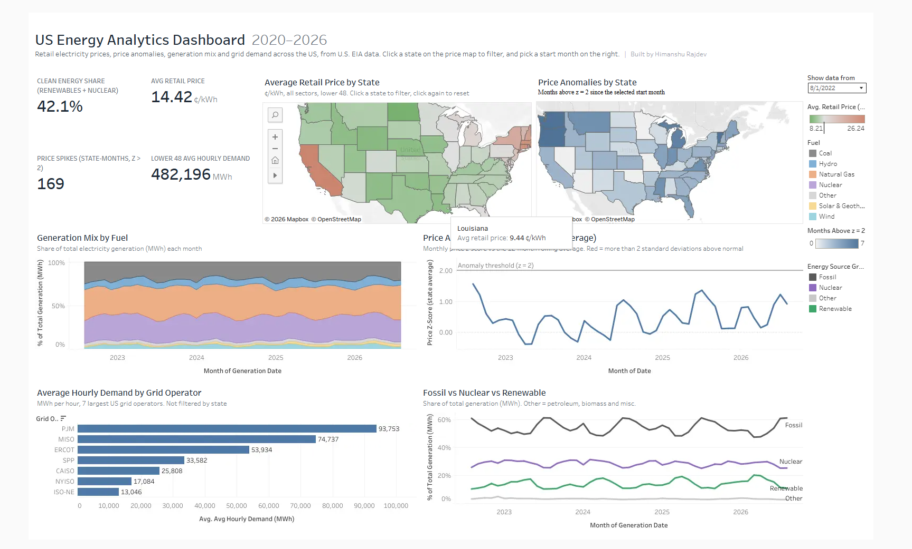

# US Energy Analytics

**Live dashboard** [US Energy Analytics Dashboard on Tableau Public](https://public.tableau.com/app/profile/himanshu.rajdev/viz/USEnergyAnalyticsDashboard20202026/USEnergyAnalyticsDashboard20202026)



A dashboard of US electricity from 2020 to 2026. It shows where power costs the most, which states had unusual price jumps, what the electricity is made from, and how much the biggest grid operators use hour by hour. All data comes from the US Energy Information Administration (EIA).

Behind it is a pipeline that collects, cleans and refreshes the data on a schedule, so nothing is rebuilt by hand. The goal was something that runs end to end, not a notebook with a few charts.

---

## The dashboard

At the top are four headline numbers.

- **Clean energy share** is renewables plus nuclear as a share of total generation.
- **Average retail price** is in cents per kWh.
- **Price spikes** counts state-months where the price ran more than 2 standard deviations above its 12-month average.
- **Lower 48 average hourly demand** is in MWh.

Below them are six charts.

| Chart | What it shows |
|---|---|
| Average Retail Price by State | Map of cents per kWh, all sectors, lower 48. Click a state to filter the dashboard and click again to reset. |
| Price Anomalies by State | Map of how many months each state spent above z = 2 since the selected start month. |
| Generation Mix by Fuel | Stacked area of each fuel's share of generation by month (coal, hydro, natural gas, nuclear, solar and geothermal, wind, other). Follows the selected state. |
| Monthly Price Z-Score | Line of the monthly price z-score against the 12-month rolling average, with the z = 2 threshold marked. |
| Average Hourly Demand by Grid Operator | Bars for the 7 largest US grid operators (PJM, MISO, ERCOT, SPP, CAISO, NYISO, ISO-NE). Not filtered by state. |
| Fossil vs Nuclear vs Renewable | Lines for each group's share of generation over time. Other is petroleum, biomass and miscellaneous. |

A "Show data from" picker sets the start month. The headline numbers and the anomaly map follow it.

**How a z-score works here.** For each state and month, the price is compared with the average and standard deviation of that state's last 12 months. A z-score above 2 means the price was unusually high for that state. The warehouse flags anything beyond 2.5 as an anomaly (`is_anomaly`) and the dashboard shows the 2.0 line.

---

## How it works

```
EIA API -> S3 (raw JSON) -> BigQuery (raw -> staging -> marts) -> Google Sheet -> Tableau Public
            Airflow in Docker runs the whole chain once a month
```

1. **Ingest.** Three tasks pull retail prices, generation and hourly demand from the EIA API and save one gzipped JSON file per dataset per month in S3, at `raw/<dataset>/year=YYYY/month=MM/data.json.gz`.
2. **Load.** The BigQuery `eia_raw` tables are cleared and reloaded from those files. Each record is stored as a JSON string, exactly as EIA sent it.
3. **Staging.** SQL turns the JSON into typed columns, removes duplicates and upserts into `eia_staging` with `MERGE`.
4. **Marts.** SQL builds the tables the dashboard reads in `eia_marts`, including the rolling z-scores and the fuel groupings.
5. **Validate.** The run fails if any mart table is empty.
6. **Publish.** Small versions of the marts are written to a Google Sheet. Tableau Public cannot connect to a database, but it refreshes workbooks that are connected to Google Sheets on its own.

### Why each run re-pulls three months

EIA publishes monthly retail and generation data about two months late, and it revises recent months. Asking only for the current month returns nothing. So every run re-pulls the last 3 months (`lookback_months`), overwrites those S3 files, and the merge step upserts any changes. Running it again is always safe.

Hourly demand is large, so it is pulled one month at a time and saved as each month finishes. The client retries when EIA drops a connection.

### What is in the Google Sheet

| Tab | One row per | Feeds |
|---|---|---|
| `fact_retail_prices` | state and month | price maps, z-score line, spike count |
| `fact_generation` | state, month and fuel category | generation mix, fossil vs nuclear vs renewable |
| `fact_rto_heatmap` | month, hour of day and grid operator | demand views |
| `fact_rto_regional` | month and grid operator | demand by grid operator |
| `fact_anomaly_leaderboard` | state | anomaly counts |
| `dim_state` | state | state names |

Generation is rolled up from about 1.3 million fuel-code rows to one row per fuel category so it fits in a Sheet. Column headers are in capitals, and ID and period columns are forced to text so Sheets does not turn `2020-01` into a date.

---

## Data

All three datasets come from the EIA Open Data API.

- **Retail electricity prices** are monthly by state and sector from 2020. The marts keep the all-sectors rows.
- **Generation by fuel** is monthly by state and fuel type.
- **Hourly demand** is by balancing authority. The EIA endpoint returns four series for every region and hour (demand, day-ahead forecast, net generation and interchange). The pipeline keeps only demand (`type = D`).

---

## Run it

**Prerequisites** are Python 3.11, Docker, an EIA API key, an AWS account with an S3 bucket, and a Google Cloud project with billing linked.

1. Copy `.env.example` to `.env` and fill it in. Save it with LF line endings.
2. In Google Cloud, enable the BigQuery and Google Sheets APIs. Create a service account with the BigQuery Data Editor and BigQuery Job User roles and save its key as `secrets/gcp.json`.
3. Share your Google Sheet with the service account email as Editor and put its ID in `.env` as `SHEET_ID`.
4. Load everything already in S3 into BigQuery.
   ```
   pip install -r requirements.txt
   python -m scripts.rebuild_from_s3 --start 2020-01
   ```
5. Catch up to today and fill the Sheet.
   ```
   python -m scripts.run_pipeline --lookback 9 --publish
   ```
6. Check every stage.
   ```
   python -m scripts.check_all
   ```
7. Start Airflow.
   ```
   docker compose up -d --build
   ```
   The UI is at `http://localhost:8080`. The DAG `eia_pipeline_dag` runs on the 2nd of each month at 14:00 UTC. You can also trigger it by hand and change `lookback_months`.
8. In Tableau Public, connect a data source to each Sheet tab and publish.

Other scripts that help when something looks wrong.

| Script | Use |
|---|---|
| `scripts/check_sheet.py` | Tests the Google Sheet connection and says what is wrong |
| `scripts/publish_sheet.py` | Rewrites the Sheet from BigQuery without calling EIA |
| `scripts/diagnose_rto.py` | Inspects the raw demand rows and runs the demand staging step |

---

## Cost

Everything runs inside free tiers.

- BigQuery gives 10 GB of storage and 1 TB of queries a month. Load jobs are free. Every query has a 50 GB billing cap (`BQ_MAX_BYTES_BILLED`).
- A billing account must be linked to the project. BigQuery's no-billing sandbox blocks `MERGE` and `TRUNCATE` and deletes tables after 60 days.
- S3 holds a few hundred MB of compressed JSON.
- Tableau Public, Google Sheets and local Airflow cost nothing.

---

## Design decisions

- **Snowflake to BigQuery.** The first version ran on Snowflake. The warehouse cost too much for a side project, so it moved to BigQuery's free tier. The Snowflake code is in `legacy/`.
- **One DAG.** The first version had separate ingest and transform DAGs started an hour apart. One DAG with ordered tasks removes the timing gap.
- **Demand series filter.** The first version averaged all four EIA demand series into one number. The current version keeps only demand, which changed the demand charts.
- **Google Sheet as the bridge.** Tableau Public has no database connector. The Sheet is the only source it refreshes on its own, so the tables written there are sized to fit.

---

## Known limits

- Airflow runs on a laptop, so a run only happens while Docker is up. If the laptop is off on the scheduled day, the missed run starts the next time Docker starts.
- Retail and generation data lag by about two months, so the newest months on the dashboard are behind.
- EIA demand readings sometimes include odd values, such as negative averages or very large peaks. The pipeline does not clean them.
- Some rows are national or regional totals rather than states, such as `US` and a few generation location codes. The state maps ignore them.
- Airflow does not send failure alerts. Check the UI or run `python -m scripts.check_all`.

---

## Project structure

```
dags/eia_pipeline_dag.py       # monthly DAG
src/
  eia_client.py                # EIA API client with retries
  s3_client.py                 # S3 read and write
  bq_client.py                 # BigQuery helper
  pipeline.py                  # steps shared by the DAG and the scripts
  sheets_export.py             # writes the Google Sheet
sql/bigquery/
  00_create_tables.sql
  staging/                     # RAW to STAGING merges
  marts/create_marts.sql
scripts/                       # run, rebuild, check and publish helpers
docs/dashboard.png
Dockerfile, docker-compose.yml
legacy/                        # the Snowflake version
```

## Environment variables

See `.env.example` for the full list. The main ones are `EIA_API_KEY`, `AWS_ACCESS_KEY_ID`, `AWS_SECRET_ACCESS_KEY`, `S3_BUCKET`, `GCP_PROJECT`, `GOOGLE_APPLICATION_CREDENTIALS` and `SHEET_ID`.

## License

See `LICENSE`.
